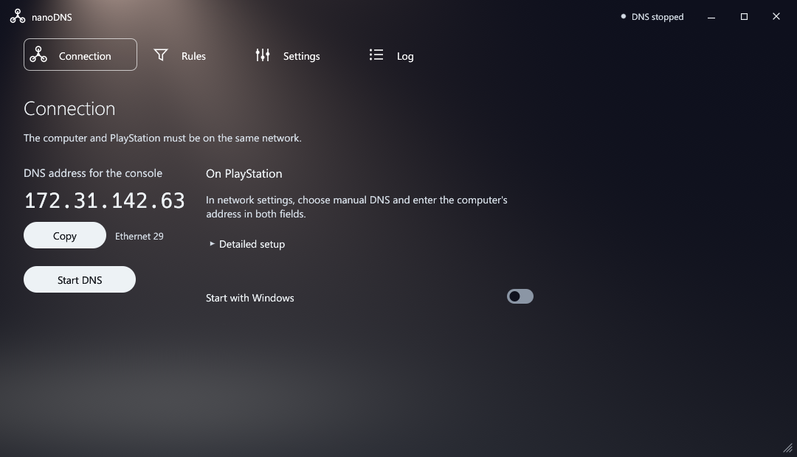

# nanoDNS Desktop

A portable DNS proxy for PS4 and PS5 on Windows 10/11 x64, with domain rules, priority exceptions and a PS5-inspired interface.

**[Download Windows x64](https://github.com/ansidium/nanoDNS-Desktop/releases/latest)** · [Screenshots](docs/images/nanodns-tabs-en.png)



## Quick start

1. Connect the computer and console to the same network.
2. Extract the ZIP and run `nanoDNS.exe`. DNS starts automatically by default. Approve Windows firewall setup if prompted.
3. On the console, choose manual DNS and enter the app’s address in **both** fields. Leave IP / DHCP and MTU automatic, with no proxy.

Keep the computer on and connected. If its IP changes, update both console DNS fields.

Automatic mode listens on the selected LAN address on **UDP port 53**. Stop DNS before changing network adapters.

By default, closing the window minimizes nanoDNS to the tray. Choose **Exit** to stop it.

The interface follows the Windows display language: **30 languages**, with English fallback. [Languages](locales/README.md).

Settings and logs: `%LOCALAPPDATA%\NanoDNS Desktop`.

## Build

Build on Windows with Rust **1.99.1**, Visual Studio C++ Build Tools and the Windows SDK:

```powershell
cargo build --release --locked --target x86_64-pc-windows-msvc
```

Linux and macOS are [planned](docs/PORTABILITY.md).

## License

Based on [nanoDNS by Drakmor](https://github.com/drakmor/nanoDNS). **GPL-3.0-only**: [LICENSE](LICENSE), [third-party and font notices](THIRD_PARTY_NOTICES.txt).
